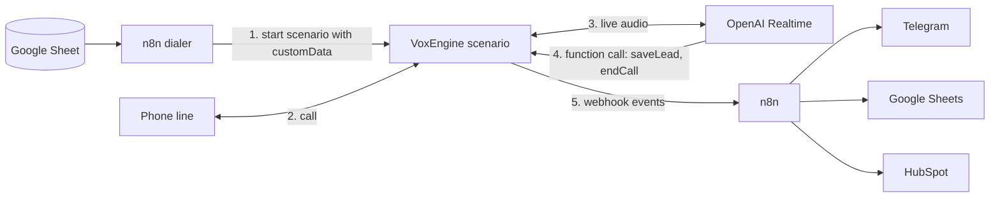

# AI phone agents

[](https://github.com/ahrimmedia-beep/ai-phone-agents/actions/workflows/ci.yml)

Voice agents that answer and make phone calls for real estate agencies. They run on Voximplant VoxEngine and talk through the OpenAI Realtime API. The agent qualifies the person on the line, saves the lead with a function call and sends the result to n8n. n8n passes it on to Telegram, Google Sheets and the CRM.

## The problem

An agency gets calls at night and on weekends, when nobody is there to answer. Managers also spend hours calling an old client base to find the few people who are ready to talk.

## What I built

- Five call scenarios: two inbound receptionists and three outbound callers, in English and Russian.
- Live voice through the OpenAI Realtime API with server-side turn detection. The caller can interrupt the agent at any moment.
- Function calling: the model saves the lead (name, contact, budget, area, bedrooms, timeline, how ready the buyer is) and ends the call itself.
- A backup for a missed tool call. After the call, the lead is recovered from the transcript with an LLM extraction, and a regex guess fills the gaps.
- Silence and length limits, so a call that goes quiet still ends and still reports its result.
- Webhook events to n8n at each step: call started, connected, failed, lead captured, and call ended with the full transcript. An n8n dialer starts the outbound calls from a Google Sheet.
- The English agents tell the caller up front that they are an AI and that the call can be recorded.

## How it works



Each call runs in one VoxEngine scenario. For an outbound call, n8n starts the scenario with the phone number in `customData`. The scenario dials the number and connects to OpenAI at the same time, so the agent is ready when the person answers. An inbound agent answers at once and plays hold music while OpenAI connects.

The greeting plays one way, from OpenAI to the call. Then the caller's audio is connected and the input buffer is cleared, to drop echo. When the caller starts talking over the agent, the buffer is cleared again and the agent stops. A call can end in several ways: the person hangs up, the model calls `endCall`, or a timer fires. All of them lead to one final event with the transcript.

Fixes made while testing on real calls:

- Function call fields arrive in `event.data.payload`, not in `event.data`. Reading the wrong place gave `name=undefined`, and only the fallback path worked. Now both event paths go through one router that skips a `call_id` it has already handled.
- VoxEngine returns the HTTP status in `res.code`. A check on `res.statusCode` always fails.
- Waiting for the webhook inside the `saveLead` handler left 2 to 4 seconds of silence on the line. The lead is now sent without waiting.
- An early version hung up when it heard a goodbye phrase in the middle of a call, before the lead was saved. Now only the model ends the call, and a silence timer is the backstop.
- Short replies were sometimes transcribed as another language, so the English agents pin the transcription language.

## Selected code

This repository holds the call-handling logic from the agents, with tests, to show how the code is written. In the deployed project each agent is a single VoxEngine file. Here the logic is split into modules that run under plain Node. The VoxEngine parts (HTTP client, call, OpenAI client) are passed in as arguments, so tests use fakes. The prompts, the tool schemas, the sample listings, the n8n workflows and the deployment setup stay private.

| File | What it shows |
|---|---|
| [`src/call-lifecycle.js`](src/call-lifecycle.js) | The call as a small state machine: it ends exactly once, whatever ends it. Also the silence and length timers, the one-way greeting and then two-way audio, barge-in, and the final events in a fixed order. |
| [`src/realtime.js`](src/realtime.js) | OpenAI Realtime session config with server VAD, reading event fields that move between SDK versions, and one function-call router for two event paths. |
| [`src/lead.js`](src/lead.js) | The transcript and the lead: tool arguments to a lead, and recovery from the transcript with an LLM in JSON mode plus a regex fallback. |
| [`src/webhook.js`](src/webhook.js) | Webhook events through the VoxEngine HTTP client with a shared secret header. A failed webhook never breaks a live call. |
| [`examples/outbound-scenario.js`](examples/outbound-scenario.js) | How these modules come together in an outbound VoxEngine scenario. Prompts and tools are removed. |

```bash
npm install
npm test           # 78 tests, Node 22.18+
npm run typecheck  # JSDoc types checked by tsc
```

## Stack

Voximplant VoxEngine (JavaScript), OpenAI Realtime API (gpt-realtime models, server VAD, function calling), gpt-4o-transcribe, gpt-4o-mini in JSON mode, n8n, Telegram, Google Sheets, HubSpot. Tests with node:test, types with JSDoc and TypeScript.

## My role

I built the project alone: agent design, prompts, call logic, the n8n workflows and the integrations.

## License

Published for viewing only. All rights reserved, see [LICENSE](LICENSE).
